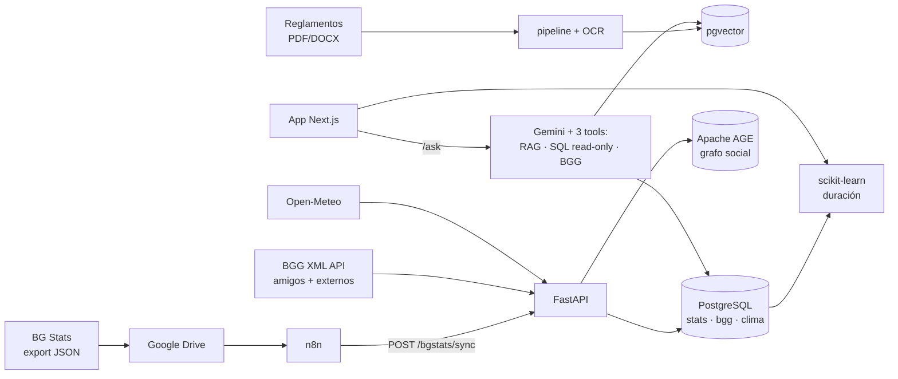

# boardgames-assistant

Asistente personal de juegos de mesa que corre en un servidor propio (homelab con Ubuntu).
Responde preguntas de reglas con RAG sobre los reglamentos, analiza mi historial de partidas
y predice cuánto va a durar una partida con un modelo de machine learning. Lo consume la app
[Boardgames Assistant](https://github.com/AlbertQu1/Loggers/tree/master/Boardgames%20Assistant)
(Next.js, mismo monorepo que Coffee Logger / Soda Stream Logger).

## Resumen

| | |
|---|---|
| **Problema** | Los reglamentos están dispersos en PDFs de varios idiomas, y mis datos de juego (BG Stats) no responden preguntas como "¿qué juego conviene para 3 personas?" o "¿cuánto nos va a durar esto?". |
| **Stack** | Python · FastAPI · PostgreSQL 18 (pgvector + Apache AGE) · scikit-learn · Gemini (function calling) · n8n · Google Drive API · BoardGameGeek XML API · Open-Meteo · systemd |
| **Datos** | 2,350 partidas propias de 453 juegos · 5,504 partidas de 11 amigos · 12,514 partidas de 17 usuarios externos de BGG · metadata de 2,494 juegos · 2,371 fragmentos de 35 reglamentos |
| **Resultados** | Modelo de duración: error promedio (MAE) de **15.0 min**, contra 26.5 min de un baseline que siempre predice el promedio (−43 %). Modo solitario: 11.5 vs 25.0 min. Sync de punta a punta automatizado: exportar desde el teléfono actualiza la base, los datos de BGG, el clima, el grafo social y los modelos. |

### Arquitectura



### Decisiones de ingeniería que vale la pena destacar

- **Evaluación honesta antes de meter más datos.** Sumar 12,514 partidas de usuarios externos parecía obvio, pero la validación cruzada (midiendo el error *solo sobre mis partidas* y recalculando el historial por juego dentro de cada fold, para no filtrar el target) mostró que **empeoraba** el modelo principal (13.4 → 15.5 min), porque otros grupos juegan más lento. Esos datos se quedaron únicamente en el modelo de respaldo para juegos nunca jugados, donde sí ayudan (21.1 → 20.5 min). Ver `source/eval_externos_duracion.py`.
- **Separación estricta de fuentes.** Las partidas propias, las de amigos y las de desconocidos viven en tablas distintas y nunca se fusionan a nivel de tabla. Los desconocidos alimentan estadísticas y ML, pero no el grafo social.
- **Seguridad del agente.** El LLM consulta la base con un rol de Postgres de solo lectura (`boardgames_readonly`). No puede escribir aunque genere SQL malicioso o erróneo.
- **Calidad de datos.** Resolución de identidades entre registros de distintas personas (alias por usuario de BGG), exclusión de jugadores anónimos que antes inflaban el grafo, detección de bots/Automa y de partidas digitales, y geocodificación de lugares.
- **Robustez operativa.** Upserts idempotentes en todos los syncs, reintentos con backoff ante el rate limit de BGG, cada paso del sync aislado para que uno que falle no tumbe al resto, y cambios de esquema versionados en `sql/`.

## Detalle por fase

**Estado actual:**
- ✅ Fase 0 — pipeline de indexado (extraer → trocear → embeber → guardar en pgvector), validado con varios juegos reales, multilenguaje (es/en), OCR automatico como fallback para PDFs sin texto real, y expansiones ligadas al juego base.
- ✅ Fase 2 — schema `boardgames_stats.*` (juegos/jugadores/lugares/partidas/partida_jugadores) sincronizado desde export de BG Stats, automatizado end-to-end via Google Drive + n8n (ver `source/bgstats_sync.py` y `POST /bgstats/sync`).
- ✅ Fase 3 — backend `/ask` con 3 herramientas para Gemini: `search_rulebooks` (RAG), `query_sql` (SQL de solo lectura sobre `boardgames_stats.*`, rol Postgres `boardgames_readonly` sin permisos de escritura) y `bgg_lookup` (busqueda en vivo en BoardGameGeek, ultimo recurso cuando un juego no esta en la biblioteca local ni tiene reglamento indexado — cachea el resultado en `boardgames_bgg.juegos_detalle` para no repetir el request). Gemini elige cual usar segun la pregunta, y se le indica ser decisivo: en cuanto tenga metadata suficiente para una opinion fundamentada, responder en vez de seguir iterando buscando confirmacion perfecta. **Agregado 2026-08-17:** `/ask` acepta un `historial` opcional (ultimos 6 turnos pregunta/respuesta) que se antepone a `contents` antes de llamar a Gemini, para que preguntas de seguimiento sin repetir el nombre del juego ("¿cuando se acaba la partida?") mantengan contexto — antes cada request empezaba de cero, sin memoria de la conversacion.
- ✅ Fase 1 — ingesta de reglamentos sin SSH, validada end-to-end (subida real desde compu y desde telefono, ambas indexadas correctamente). Dos caminos, ambos disponibles en la app:
  1. **Subida directa**: pestaña "Agregar" → eliges archivo del dispositivo → llenas el formulario → indexa al toque (`POST /reglamentos/subir`).
  2. **Buzon asincrono**: subes el PDF/DOCX a una carpeta de Google Drive ("Reglamentos") desde cualquier dispositivo → un workflow de n8n lo baja solo a `pdfs_prueba/pendientes/` y mueve el original a una subcarpeta "Procesados" en Drive → la pestaña "Agregar" muestra un badge con el conteo y una lista de pendientes → completas el formulario despues, desde donde sea, y confirmas (`POST /reglamentos/confirmar`). Pensado para cuando subes el archivo en un momento y quieres poner el nombre/idioma despues, sin notificacion activa (se revisa la app cuando se abre, a proposito mas simple que configurar email/push).
- ✅ Fase 4 — dashboard de BG Stats en la app (`app/bg-stats`): resumen, top juegos, colección/gasto, clima, cuándo juegas (con probabilidad por día, ver abajo), top lugares con mapa.
- ✅ Fase 5 — BGG API (mecánicas/categorías/complejidad/rating, `boardgames_bgg.juegos_detalle`, `source/bgg_cache_sync.py`) + clima real por lugar (Open-Meteo, `source/clima_sync.py`) + geocoding a mano vía Plus Codes para lugares sin coordenadas.
- ✅ Fase 6 — analítica avanzada:
  - **Modelo de duración** (`source/duracion_model.py`): predice `duracion_min` con peso/complejidad BGG, clima real (en vivo vía Open-Meteo para predicciones futuras), `categoria_lugar`, `grupo_social`, `tag_solo`, día de la semana e historial real del mismo juego. MAE 15.0 min vs 26.5 de baseline (2026-11-20). Para juegos nunca jugados usa un modelo de respaldo entrenado además con partidas de usuarios externos (MAE 20.5 min). Endpoint `/bgstats/duracion/predecir`, toggle en `app/ml`.
  - **Modelo de duración en modo solitario** (`source/duracion_solo_model.py`): dataset separado (`tag_solo=true`), features más simples + `min_jugadores`/`max_jugadores` de BGG (distingue solo puro de multijugador con Automa). MAE 11.5 min vs 25.0 de baseline. Endpoint `/bgstats/duracion-solo/predecir`.
  - **Red de amigos** (`boardgames_bgg.*`): partidas que amigos con cuenta de BGG registraron directo ahí (staging propio, `source/bgg_friend_plays_sync.py`, **nunca se fusiona con `boardgames_stats.*`** — unión solo en memoria para el modelo, nunca a nivel de tabla). Detección de bots/Automa (`tag_solo`) y plataformas digitales (`tag_digital`, ej. BGA). Identidades cruzadas a mano en `boardgames_bgg.jugadores_identificados` (~125 personas), lugares en `boardgames_bgg.ubicaciones_amigos_alias`.
  - **Usuarios externos de BGG** (`boardgames_bgg.usuarios_externos`/`plays_externos`, 2026-11-20): partidas públicas de jugadores que no conozco, con país/estado del perfil, coordenadas de la capital del estado y clima diario de ese punto. Alimentan estadísticas (temporada, número real de jugadores, popularidad) y el modelo de respaldo de duración, nunca el grafo social. Antes de dar de alta a alguien se valida que exista, que no sea ya un amigo y cuántas de sus partidas traen duración.
  - **`boardgames_bgg.juego_familia`**: agrupa ediciones/reimpresiones del mismo juego (ej. Everdell + Complete Collection) para que el historial real no se fragmente por `bgg_id`; el chat (`query_sql`) lo usa automáticamente.
  - **Grafo social** (Apache AGE, extensión sobre la misma Postgres, `source/grafo_social_sync.py`): nodos = personas (propias + identificadas de amigos + visitantes) y un nodo `Casa`; relaciones `JUEGA_CON_PROPIO`/`JUEGA_CON_AMIGOS` (separadas) y `VISITO` (persona → Casa, peso = número de visitas, desde `calendario_eventos`). Los nodos `Persona` de visitas se crean directo del nombre del evento, no solo de quien ya juega — alguien puede visitar y afectar patrones de consumo sin haber jugado nunca. Permite consultas multi-salto (quién conecta a X con Y, puentes entre redes) directo en SQL vía `cypher()`, sin motor de grafos aparte. Se actualiza en cada sync de BG Stats.
  - **Calendario + vacaciones** (`source/calendario_sync.py`): visitas (iCloud **+ `home_visits`** de la app Vacaciones, dos fuentes fusionadas) + viajes (`vacation_trips`, misma DB separada) → `boardgames_stats.calendario_eventos`, cruzable con partidas/grupo_social ("¿con quién juego cuando estoy de viaje?"). Nombres de visita que no matchean exacto contra `jugadores` se resuelven vía `boardgames_stats.visita_nombre_alias` (alias manuales que sobreviven re-syncs, mismo patrón que `jugadores_identificados` para amigos de BGG).
  - **3 badges en la app** (amigos nuevos con BGG, lugares/fuentes de compra sin normalizar, partidas anónimas sin grupo social) — detectados automático en cada sync, se resuelven desde la UI.

**Nombre del juego al agregar un reglamento:** ya no se escribe a mano. El campo busca en
vivo en BGG (`GET /juegos/bgg-buscar?q=`, xmlapi2 `search` + un `thing` en batch para
resolver nombre primario/imagen/popularidad) y se eligen resultados de una lista con
caratula, año y si es expansion. Lo que hace el import limpio es el cruce por `bgg_id`
contra `boardgames_stats.juegos`: si el juego ya esta en tu biblioteca se usa el nombre
local — el mismo con el que estan indexados sus chunks — en vez del de BGG, asi que
buscar "aventureros al tren" o "los colonos de catan" deja `Ticket to Ride` y `CATAN`,
no un nombre nuevo que partiria el reglamento en dos juegos distintos. Cada resultado
marca ademas `en_biblioteca` y `ya_indexado` (este ultimo es justo lo que rechaza
`/reglamentos/subir` con 409). El search de BGG no viene ordenado por relevancia — se
pre-ordena por parecido del nombre antes de pedir el detalle, si no para "carcassonne"
salen fan-expansions de 5 votos y el juego base ni aparece. Resultados cacheados 10 min
en memoria porque el autocompletado dispara muchas busquedas.
**Eliminado 2026-08-17:** `GET /juegos/bgg-lookup` (el campo aparte para pegar un link de
BGG) se quito por completo — habia dos buscadores distintos para el mismo problema, y el
de "Juego" ya cubre ambos casos (nombre exacto o parecido) con mejor UX (lista de opciones
en vez de un solo resultado auto-resuelto). El ranking usado ahi se extrajo a
`bgg_buscar_enriquecido()` (compartido, un solo criterio de "cual es el mejor match" en
vez de dos rankings distintos para la misma busqueda — bug real que se encontro al hacerlo:
el fallback por nombre usaba el preordenamiento burdo de `bgg_buscar_items()` en vez del
ranking final con popularidad/biblioteca, dando resultados incorrectos).
iCloud Drive se descarto como alternativa a Google Drive para el buzon asincrono — Apple
no ofrece API publica para automatizacion de terceros.

**Limitacion conocida:** el backend usa el tier gratuito de la API de Gemini, que tiene
un limite duro de 20 requests/dia por modelo — cada pregunta consume 2-3 requests
(ciclo de busqueda/consulta), asi que en la practica el limite real es ~7-10 preguntas/dia.
Suficiente para probar, no para una noche de juego real. Subir a billing de pago
(~$0.01-0.02 USD/pregunta) resuelve esto sin tocar codigo — pendiente de decidir.

## Setup

```bash
conda env create -f environment.yml
conda activate boardgames
cp .env.example .env  # ajusta DATABASE_URL, DATABASE_URL_READONLY, GEMINI_API_KEY
```

OCR (para PDFs sin texto real, ej. libros de reglas muy ilustrados) necesita paquetes
del sistema, aparte del conda env:

```bash
sudo apt install -y tesseract-ocr poppler-utils
```

## Uso

```bash
# Indexar un reglamento (PDF o DOCX) — usa OCR automaticamente si el PDF no tiene texto real
python source/pdf_pipeline.py --juego "Wingspan" --pdf pdfs_prueba/wingspan.pdf \
    --idioma es --doc-type reglamento

# Indexar una expansion (queda ligada al juego base en la busqueda)
python source/pdf_pipeline.py --juego "Wingspan: European Expansion" \
    --pdf pdfs_prueba/wingspan-europa.pdf --juego-base "Wingspan"

# Probar el retrieval crudo (sin LLM, solo pgvector)
python source/query_test.py --pregunta "Como se calcula el puntaje final?" --juego "Wingspan"

# Sincronizar un export de BG Stats a Postgres (idempotente, upsert por uuid)
python source/bgstats_sync.py --archivo bgstats_data/BGStatsExport.json

# Levantar el backend de consumo (Fase 3)
uvicorn source.api:app --host 0.0.0.0 --port 8000 --reload

# Probar /ask con salida legible (en otra terminal, con el backend arriba)
python source/ask_cli.py --pregunta "Como se juega para 2 jugadores?" --juego "Wingspan"
python source/ask_cli.py --pregunta "Mejores juegos que tengo para 3 personas?"

# Ver que hay esperando info en pdfs_prueba/pendientes/ (llegan ahi via n8n + Drive)
curl http://localhost:8000/reglamentos/pendientes

# Sincronizar partidas de amigos (BGG), un usuario o todos los que tengan bgg_username
python source/bgg_friend_plays_sync.py --username VINICIO
python source/bgg_friend_plays_sync.py --todos

# Usuarios BGG EXTERNOS (desconocidos, sin grupo social): solo alimentan stats/ML,
# nunca el grafo social. --agregar-externo valida en BGG, rechaza a quien ya es amigo,
# guarda pais/estado/coords (capital del estado) y descarga sus partidas
python source/bgg_friend_plays_sync.py --agregar-externo usuario1 usuario2
python source/bgg_friend_plays_sync.py --externos

# Clima de amigos (por lugar / proxy CDMX) y de externos (capital del estado, incremental)
python source/bgg_friend_clima_sync.py

# Cachear metadata de BGG (propios + amigos + juegos de externos aun no cacheados)
python source/bgg_cache_sync.py

# Actualizar el grafo social (Apache AGE) con el estado actual de la base
python source/grafo_social_sync.py

# Sincronizar visitas + vacaciones al calendario (cruzable con partidas/grupo_social)
python source/calendario_sync.py

# Probar el modelo de duracion (normal o modo solitario) suelto, sin la API
python source/duracion_model.py
python source/duracion_solo_model.py

# Evaluar si los datos externos/amigos mejoran la prediccion (MAE solo sobre partidas propias)
~/miniconda3/envs/boardgames/bin/python source/eval_externos_duracion.py
```

`POST /bgstats/sync` (el que dispara n8n en cada export nuevo) encadena TODO lo anterior
automatico: partidas/juegos/jugadores → calendario → cache BGG → partidas de amigos →
partidas de externos → clima de externos → grafo social. Cada paso extra tiene su propio
manejo de errores para no tumbar el sync principal si uno falla (red, API caida). Las
descargas de BGG reintentan con backoff si BGG responde 429/202/503 (rate limit).

### Modelo de duracion y datos externos

El modelo principal (juegos que ya jugaste) se entrena SOLO con partidas propias: sumar
amigos o externos lo empeoraba (sus partidas duran mas: mediana 35 y 30 min vs 22 propias).
El **fallback** (juegos nunca jugados) se entrena con propias + `plays_externos`, marcadas
con `es_externo=1`; al predecir siempre va `es_externo=0`. Su MAE y la eleccion del modelo
se miden solo en partidas propias de juegos jugados una vez (el caso real de uso):
21.14 → 20.55 min (2026-11-20). Ver `source/eval_externos_duracion.py`.

Los reglamentos (PDF/DOCX) no se versionan (`.gitignore`) por derechos de autor —
van en `pdfs_prueba/` localmente. El export de BG Stats (`bgstats_data/`) tampoco se
versiona — son datos personales.

## Schemas

**`boardgames.rulebook_chunks`** — cada chunk guarda: `juego`, `juego_base` (si es
expansion), `idioma`, `doc_type` (`reglamento`/`errata`/`faq`), `source_pdf`,
`chunk_text`, `embedding` (384-dim, `paraphrase-multilingual-MiniLM-L12-v2`).

**`boardgames_stats.*`** — `juegos`, `jugadores` (con `grupo_social`), `lugares` (con `lat`/`lon`,
`categoria_lugar`, `grupo_social_lugar`), `partidas` (con `tag_solo`, `tag_digital`),
`partida_jugadores`, `partida_grupo_social_override` (preserva `grupo_social` cuando un
jugador se anonimiza en BG Stats), `calendario_eventos` (visitas/vacaciones),
`colecciones` + `fuentes_compra_alias`/`categoria`, `lugares_pendientes_revision` y
`anonimos_pendientes_agrupar` (badges). Todo referenciado por `uuid` (mismo uuid que usa
BG Stats internamente, permite upsert idempotente en cada sync). Ver
`source/bgstats_sync.py` para el mapeo completo.

**`boardgames_bgg.*`** — `juegos_detalle` (cache BGG: peso, categorías, mecánicas, rating —
de TODOS los juegos, propios y de amigos), `plays_amigos` (staging de amigos, nunca se
fusiona con `boardgames_stats.*`), `jugadores_identificados`, `ubicaciones_amigos_alias`,
`clima_ubicacion_diario`/`clima_cdmx_diario`, `juego_familia`, `amigos_nuevos_pendientes`
(badge).
- `jugadores_identificados.bgg_username`: opcional. NULL = el alias aplica a los logs de
  todos los amigos; con valor = solo a los `plays_amigos` de ese usuario y gana sobre la
  fila global (ej. "alex" en un log es una persona y en otro log es otra).
- `usuarios_externos` (lista de usuarios BGG ajenos + `pais`/`estado`/`lat`/`lon` de la
  capital del estado; BGG no expone ciudad), `plays_externos` (mismo layout que
  `plays_amigos`), `clima_externos_diario` (clima por punto lat/lon + fecha).

**`red_social`** (Apache AGE) — grafo de personas + nodo `Casa` + relaciones `JUEGA_CON_PROPIO`/
`JUEGA_CON_AMIGOS`/`VISITO`. Requiere `LOAD 'age'; SET search_path = ag_catalog, "$user", public;`
antes de usar `cypher()`. Ver `source/grafo_social_sync.py`. Los nombres de relleno
("Anonymous player", "Jugador anónimo", "jugador Inicial"...) y los jugadores `es_anonimo`
no generan nodos; un nombre sin ligar que choca con una persona ya identificada se guarda
como "Nombre (usuario_bgg)". Los externos nunca entran al grafo.

Cambios de esquema fechados en `sql/` (se aplicaron a mano en la base `casa`).
